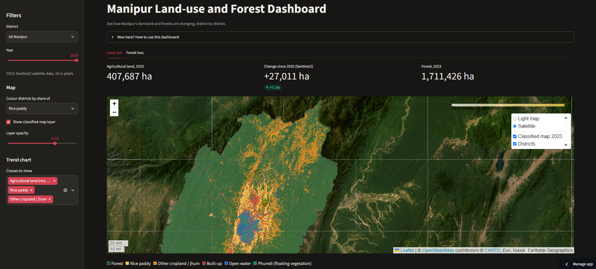

# Manipur Land Use & Forest Dashboard

See how Manipur's farmland and forests are changing, district by district.

An interactive dashboard that maps land use in Manipur, India (rice paddy, other cropland and jhum, forest, built-up areas, water and phumdi) from free satellite data, with yearly trends and forest-loss charts.

**Live app:** [paste your streamlit.app link here]

<!-- Add a screenshot: take one of the running app, upload it to this repo
     (Add file > Upload files), then replace the line below with:
      -->


## What you can do

- Pick a district (or "All Manipur") and a year.
- See an interactive map of the classified land cover, with districts shaded by the share of a land type you choose.
- Follow trend lines of agricultural land over the years.
- Compare the land-use mix of all districts for the selected year.
- Open the **Forest loss** tab for yearly and cumulative tree-cover loss.

## How it works

1. **Satellite data:** cloud-masked seasonal composites from Landsat and Sentinel-2 (optical), plus Sentinel-1 radar for recent years, processed with Google Earth Engine.
2. **Classification:** a Random Forest classifier trained on hand-labelled points. Inputs are seasonal vegetation and moisture indices (NDVI, NDMI), radar, elevation and slope.
3. **Statistics:** areas in hectares per land-use class and district, exported as CSV files.
4. **Dashboard:** a Streamlit app (Folium map, Plotly charts) that reads those files.
5. **Forest loss:** Hansen / UMD Global Forest Change data (2001 onward).

## Data years

[Update this section whenever you add years. For example: Landsat 2020 and Sentinel-2 2021 to 2023.]

## Accuracy and limitations

Please read these before using any number from the dashboard.

- These are **computer estimates from satellite images, not official statistics.**
- Overall accuracy on held-out test points for 2023 was about 77% (kappa about 0.72). [Update this number whenever you retrain.]
- The weakest classes are **phumdi versus open water** and **forest versus jhum / other cropland**.
- Older years and Landsat-based years (30 m pixels) are less certain than recent Sentinel-2 years (10 m pixels). A jump where the satellite changes should not be read as real land change.
- Training labels were made from recent imagery. Applying them to past years assumes the land looked the same then, which cannot be fully checked.
- Forest loss from Hansen data includes shifting-cultivation (jhum) clearing and fires where trees can regrow, so it is not the same as permanent deforestation.
- District boundaries come from FAO GAUL and areas are approximate.

## Data sources and credits

- Landsat: USGS / NASA
- Sentinel-1 and Sentinel-2: contains modified Copernicus Sentinel data, ESA
- Forest loss: Hansen / UMD / Google / USGS / NASA (Global Forest Change)
- Elevation: SRTM (NASA / USGS)
- Land cover reference samples: ESA WorldCover
- District boundaries: FAO GAUL
- Processing: Google Earth Engine
- Base maps: CARTO and Esri

## Run it on your computer

```
pip install -r requirements.txt
streamlit run app.py
```

Then open http://localhost:8501 in your browser. Without a `data/` folder the app starts in demo mode with made-up numbers and a warning banner.

## Files

| File | Purpose |
|---|---|
| `app.py` | The Streamlit dashboard |
| `demo_data.py` | Made-up data used only when no real data is found |
| `requirements.txt` | Python packages |
| `data/area_by_district.csv` | Hectares per land-use class, district and year |
| `data/districts.geojson` | Simplified district outlines |
| `data/bounds.json` | Map extent for the image layers |
| `data/overlays/classes_YEAR.png` | Classified map image for each year |
| `data/forest_loss_by_district.csv` | Forest loss per district and year |

## Updating the data

The data files are produced in Google Colab with Google Earth Engine and then copied into the `data/` folder. Upload changed files to GitHub with the same names and the app updates itself.

## Privacy

The dashboard shows only district-level totals and classified maps. It does not contain, and should not be used to publish, locations of individual fields, households or sensitive activities.

## License

[Choose a license for the code, for example MIT, and add a LICENSE file. State the terms for the data files here too.]

## Contact

[Your name or organisation, and an email or link for questions and corrections.]
